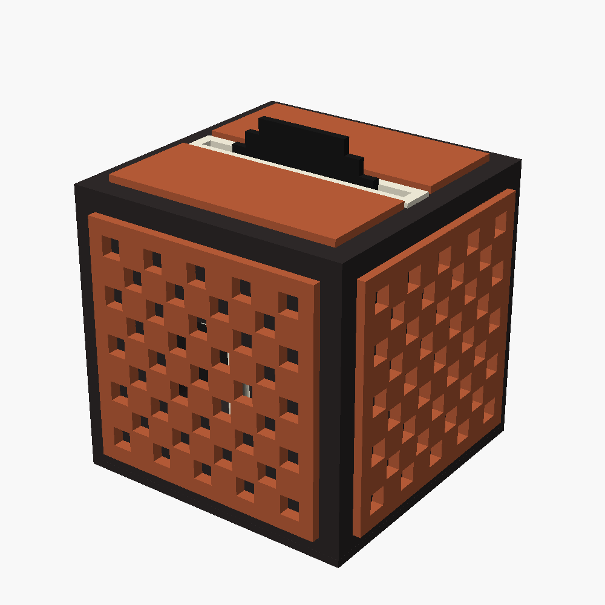

# Музыкальный куб — джукбокс из Minecraft 🎵

[English](README.md) · **Русский**



Джукбокс из Minecraft: ребёнок вставляет в щель сверху пиксельную пластинку — куб играет привязанную к ней песню, сказку или плейлист.
Вынул пластинку — пауза. Вставил ту же — играет дальше с того же места.

```
 диск с NFC-меткой
        │  (несколько мм пластика)
        ▼
   PN532 (I2C) ──► ESP32-S3 ──Wi-Fi──► Home Assistant
                       ▲                   │ «диск 04-A1-… = kolobok.mp3»
                       │ поток FLAC        │
                       └───────────────────┘
                   ESP32-S3 ──I2S──► MAX98357A ──► 2 динамика
```

Home Assistant решает, *что* играть (файлы лежат в его папке `/media/cube/`),
куб просто играет поток как обычный медиаплеер (`media_player.music_cube_player`).

## Файлы проекта

| Файл | Что это |
|---|---|
| `esphome/music-cube.yaml` | Прошивка: на основе [adonno/tagreader](https://github.com/adonno/tagreader), плюс звук, кнопки и подсветка. Проверена `esphome config` (ESPHome 2026.10.1) |
| `homeassistant/music_cube_automation.yaml` | Автоматизация: диск → музыка, снял → пауза, вернул → дальше |
| `cad/music_cube.scad` | Параметрическая 3D-модель джукбокса (OpenSCAD): каркас, дно, панели, пластинки |
| `cad/preview.png` | Как выглядит модель в сборке |
| `cad/inside.png` | Внутри: шахта, плата PN532 на стойках |
| `cad/stl/*.stl` | Готовые STL всех деталей, уже повёрнуты для печати |

## 1. Почему ESP32-S3, а не D1 mini

ESP8266 (D1 mini) в ESPHome **не умеет воспроизводить звук** — медиаплеер ESPHome работает только на ESP32.
Поэтому в кубе стоит **ESP32-S3 с PSRAM**: PSRAM нужна для аудиобуфера.

## 2. Что докупить

| Компонент | Зачем | ≈ цена |
|---|---|---|
| **ESP32-S3 N16R8** (DevKitC-1 или клон с двумя USB-C, ~69×28 мм) | мозг + Wi-Fi + звук; PSRAM нужна для буфера | 500–700 ₽ |
| **MAX98357A** (I2S-усилитель 3 Вт) | цифровой звук прямо из ESP32 | 150–250 ₽ |
| NFC-наклейки **NTAG215 Ø25 мм**, 20–30 шт | метки в диски | 300–500 ₽ |
| 3 тактовые кнопки **6×6, высота 10 мм** | громче / тише / пауза — толкатель вровень с панелью (параметр `btn_h`) | 30 ₽ |
| USB-кабель (Ø до 4.5 мм) + блок 5 В 2 А | питание, втыкается прямо в ESP32 | — |
| 10 адресных светодиодов WS2812 (отдельные платки) + резистор 330 Ω | светящаяся щель | 100–200 ₽ |
| Плата PN532 (синяя, 78.5×49 мм) | чтение и запись NFC-меток | 300–500 ₽ |
| Саморезы M3×6 ×4 | крепление платы PN532 на стойки | — |
| Мелкие стяжки ~5 шт. | кабель от выдёргивания, ESP32 и усилитель на дне | — |
| Саморезы M3×10 потай ×4, резиновые ножки ×4 | крепление дна | — |
| Пластик: тёмный (каркас, пластинки) + терракотовый/оранжевый (панели) + яркие цвета для этикеток | | |

**Аналоговый усилитель** (PAM8403 и т. п.) тоже подойдёт: вместо MAX98357A ставите ЦАП **PCM5102A**
(те же три провода I2S) и с его выхода L/R подаёте звук на усилитель. В прошивке ничего не меняется.
MAX98357A проще: меньше проводов и нет фона от питания.

**NFC-модуль:** синяя плата PN532 78.5×49 мм с 4 отверстиями. Переведите её в режим I2C — переключателем или перемычками на плате (обозначения I2C / SET0 / SET1 напечатаны рядом).
RC522 тоже можно использовать, но он читает только UID и не умеет записывать метки HA: блок `i2c`/`pn532_i2c`
придётся заменить на `spi` + `rc522_spi`, а крепление в модели — переделать.

## 3. Схема подключения

| От | К ESP32-S3 | Примечание |
|---|---|---|
| PN532 VCC / GND | 3V3 / GND | |
| PN532 SDA / SCL | GPIO8 / GPIO9 | переключатели на модуле: I2C |
| MAX98357A VIN / GND | 5V / GND | питание от 5 В, не от 3.3 |
| MAX98357A LRC / BCLK / DIN | GPIO5 / GPIO6 / GPIO7 | |
| Динамики (спереди и сзади) | MAX98357A + / − | два динамика по 8 Ω **параллельно** (= 4 Ω, MAX98357A это держит) |
| Кнопки «громче» / «тише» / «пауза» | GPIO15 / GPIO16 / GPIO17 | второй вывод кнопки — на GND |
| WS2812 DIN / 5V / GND | GPIO4 (через 330 Ω) / 5V / GND | 10 платок цепочкой: DOUT → DIN следующей |
| Питание | USB платы ESP32 | кабель выходит через прорезь внизу задней стенки; на дне — стяжка от выдёргивания |

Если пины не подходят, их можно переназначить в блоке `substitutions` в начале YAML.

## 4. 3D-печать

Модель: `cad/music_cube.scad` — джукбокс из Minecraft. Установите OpenSCAD, откройте файл, **сначала измерьте динамики и PN532**
и поправьте параметры (`spk_d`, `nfc_len`, `nfc_wid`, `nfc_ant`, `nfc_hole_in` …) в «Customizer». Выберите `part` → F6 → Export STL.

| Деталь | Шт | Цвет | Как печатать |
|---|---|---|---|
| `body` — каркас с крышей | 1 | тёмный | крышей на стол (модель уже перевёрнута), без поддержек |
| `bottom` — дно | 1 | тёмный | плоско; на нём стоит электроника, крепится 4 винтами снизу |
| `panel_side` — панель в клетку | 4 | терракотовый | **лицом вниз** на текстурный лист — красивая фактура |
| `panel_top` — половинка крыши | 2 | терракотовый | лицом вниз; рамка-выступ сзади входит в канавку на крыше |
| `slot_unit` — шахта со щелью | 1 | **натуральный PETG или белый PLA** (светится) | рамкой на стол (модель уже перевёрнута) |
| `disc` — пластинка | сколько нужно | тёмный + цвет | плоско, с двумя остановками (ниже) |

**Как это устроено**
- Каркас тёмный, на боковых гранях ниши 1.6 мм, на крыше — канавки под рамку-выступ верхних панелей. Все панели выступают над каркасом одинаково — на 2.8 мм (параметр `panel_out`). Боковые панели 4.4 мм толщиной, верхние 2.8 мм.
- Сквозь клетки панели видна тёмная стенка — как у оригинала. Напротив динамиков (спереди и сзади) в стенке окна, звук идёт через клетки.
- Сверху между двумя половинками панели — тёмная полоса со щелью, как в Minecraft.
- Пластинка Ø84 мм (14×14 «пикселей» по 6 мм) входит в шахту вертикально и торчит на 13 мм.
- **Шахта — отдельная светлая деталь.** Она ставится изнутри, снизу (пока дно снято): светящаяся рамка выходит в отверстие крыши
  и выступает на 1.5 мм. Уступ упирается в крышу изнутри, а две ножки — в дно: шахта зажата и не провалится,
  даже если ребёнок давит пластинкой. Клей по уступу — по желанию.
- **PN532** крепится на заднюю стенку шахты на 4 стойки саморезами M3×6. Гребёнка нужна **прямая**, от шахты (угловая упрётся в стенку);
  режим I2C выставьте до установки. Антенна стоит почти напротив метки
  (смещение ~4 мм — на чтение не влияет). Перед печатью измерьте плату и расстояние от края без разъёма до центра антенны (`nfc_ant`).
- **Светодиоды** клеятся на переднюю стенку шахты (8 шт. в ряд) и на торцы (по 1 шт.). Светлый пластик рассеивает свет,
  и рамка вокруг щели светится цветом пластинки. Картинка внутренностей — `cad/inside.png`.
- Метка в центре пластинки, поэтому её можно вставить любой стороной.
- **Кнопки** спрятаны в узоре задней панели: три клетки нижнего ряда, толкатель вровень с панелью.
  Кнопка вставляется в гнездо изнутри, сзади — капля термоклея, чтобы её нельзя было продавить.
- **Кабель питания** выходит через прорезь внизу задней стенки слева, снизу её закрывает дно. Стяжка через прорези в дне не даёт выдернуть штекер.
- **ESP32 и усилитель** крепятся стяжками к дну — для ремонта всё разбирается четырьмя винтами.
  ESP32 лежит спереди разъёмом USB-C влево, под штекер с изгибом кабеля остаётся 25 мм.
  Измерьте свою плату и поправьте `esp_len` / `esp_wid`. На клонах с двумя USB-C первую прошивку заливайте через разъём **COM**.

**Пластинка: две остановки в слайсере**
1. **Пауза перед слоем Z = 1.8 мм** (первый слой над карманом) — вложить наклейку NTAG215 в круглый карман, продолжить.
2. **Смена цвета перед слоем Z = 3.2 мм** (первый слой этикетки) — этикетка-«бублик» печатается цветом: зелёная, жёлтая, красная… Цвет = тип содержимого.

Значения для слоя 0.2 мм (`layer_h`). Сверьтесь с превью слайсера.

Металла и магнитов рядом с PN532 быть не должно: задний динамик стоит примерно в 2 см от модуля, этого достаточно.
Если метки будут читаться неуверенно, уменьшите `standoff_h` (плата ближе к шахте) или `slot_clear`.

Клей для панелей: «Момент Кристалл» или цианоакрилат с гелем. Сначала соберите и проверьте электронику, панели клейте в конце.

## 5. Home Assistant

1. В ESPHome Builder создайте устройство и вставьте `esphome/music-cube.yaml`. В `secrets.yaml` добавьте
   `music_cube_api_key` (сгенерируйте новый) и `music_cube_ota_password`. Прошейте по USB, дальше можно по Wi-Fi.
2. В настройках интеграции ESPHome для куба включите **«Разрешить устройству выполнять действия Home Assistant»** —
   без этого метки и события не дойдут до HA.
3. Создайте помощник «Текст» `input_text.music_cube_last_disc` — он нужен, чтобы продолжать с того же места.
4. Положите аудио в `/media/cube/` (Samba / File editor), например `/media/cube/skazki/kolobok.mp3`.
5. Импортируйте `homeassistant/music_cube_automation.yaml` (Автоматизации → Создать → ⋮ → YAML).
6. **Привязка диска:** кладёте новый диск → приходит уведомление с его ID → дописываете строчку в `discs:`.
7. **Цвет подсветки:** у каждой пластинки в `discs:` есть `color: [R, G, B]` — пока она играет, щель «дышит» этим цветом.
   Сняли пластинку — гаснет, незнакомая пластинка — мигнёт красным. Эффекты Rainbow / Notes / Scan можно включить вручную из HA.

Совет: нажмите в HA кнопку **Write Tag Random** и приложите диск — на метку запишется ID метки HA.
Такой диск появится в разделе «Метки» и будет одинаково работать на любом tagreader в доме.

**Плейлисты и аудиокниги** удобнее вести через **Music Assistant** (дополнение HA): он знает про папки, плейлисты
и запоминает место в аудиокниге. Для таких дисков в автоматизации уже есть вариант `playlist: "Название"`.

## 6. План по выходным (вместе с ребёнком)

| Этап | Что делаем | Чем занят ребёнок |
|---|---|---|
| **1. Макет** | Собрать всё проводами на столе, прошить, проверить: метка → звук | прикладывает метки, «колдует» |
| **2. Корпус** | Подогнать размеры в OpenSCAD, напечатать каркас, дно и шахту | выбирает цвета, смотрит, как печатает принтер |
| **3. Пластинки** | Печать пластинок с паузой и сменой цвета | вкладывает метки в карман, выбирает цвет этикетки |
| **4. Сборка** | Светодиоды и PN532 на шахту, шахту изнутри в крышу, динамики, кнопки, электроника на дно, панели на клей | помогает вклеивать панели |
| **5. Наполнение** | Привязать диски к песням и сказкам | выбирает, что будет на каждой «пластинке» |

Идея: запишите на один диск ваш голос — сказку, которую читаете на ночь, или песню, которую ребёнок поёт сам.

## 7. Если что-то не работает

- **Метка не читается** — проверьте режим I2C на PN532 и что плата прикручена ко всем 4 стойкам; приложите голую наклейку прямо к модулю.
- **После изменения параметров модель «поехала»** — смотрите строки `!!! ОШИБКА` в консоли OpenSCAD: модель проверяет, что шахта, плата, пластинка и кнопки помещаются.
- **Нет звука** — проверьте 5 В на MAX98357A, порядок LRC/BCLK/DIN; включите что-нибудь на `media_player.music_cube_player` вручную из HA.
- **Звук заикается** — слабый Wi-Fi: поставьте куб ближе к роутеру, проверьте, что PSRAM определилась (в логах).
- **Событие пришло, но ничего не играет** — не включено «Разрешить устройству выполнять действия Home Assistant».

## Примечания

Комментарии в коде и модели — на русском. Если используете [Music Assistant](https://music-assistant.io/) для плейлистов,
он должен быть установлен отдельно. Всё остальное работает на стандартном Home Assistant + ESPHome.
